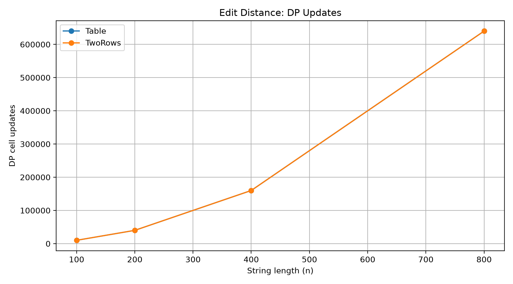
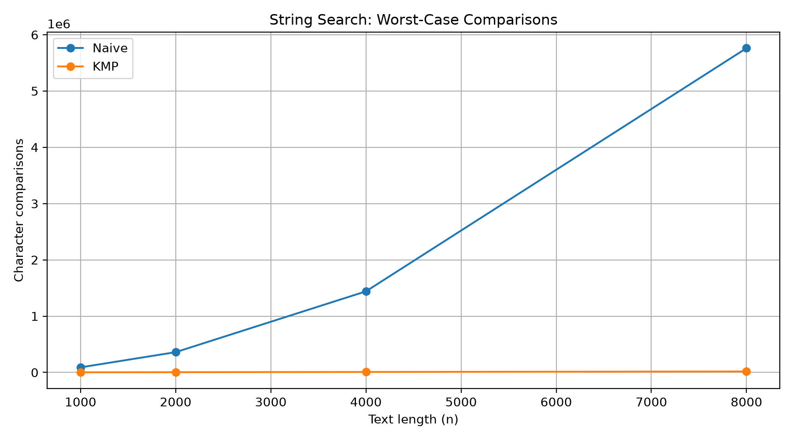
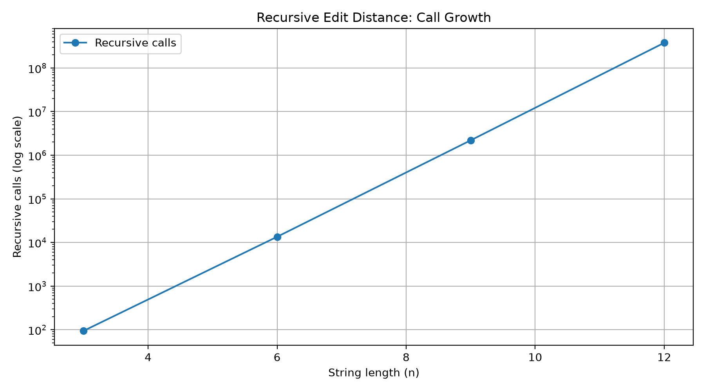

# DAA Assignment 4 — Dynamic Programming and String Algorithms

**Student:** Mansur Akhmetov  
**Group:** SE-2517  
**Course:** Design and Analysis of Algorithms  
**University:** Astana IT University

---

## 1. Experiment Design Card

### Research Questions

In this assignment, I implemented and compared three Edit Distance algorithms and two String Search algorithms.

The main questions of my experiment were:

1. How does the running time change when the input size increases?
2. How much slower is Recursive Edit Distance compared to Dynamic Programming?
3. Does Two Rows DP perform the same number of operations as Table DP?
4. How does KMP compare to Naive Search on random and worst-case inputs?

### Input Sizes

For Recursive Edit Distance, I used:

- 3, 6, 9, 12 characters.

For Table DP and Two Rows DP:

- 100, 200, 400, 800 characters.

For String Search:

- 1000, 2000, 4000, 8000 characters.

For String Search, the pattern length was 10% of the text length.

The maximum input size was at least four times larger than the minimum size in every experiment.

### Input Types

I used two types of input data.

**Random input:** Strings generated from the characters A, B, C, and D using a fixed random seed of 42.

**Worst-case input for Edit Distance:** Two strings consisting of different repeated characters, such as AAAAAA and BBBBBB.

**Worst-case input for String Search:** A text consisting only of A characters and a pattern consisting of A characters ending with B.

For example:

- Text: AAAAAAAAAAAA
- Pattern: AAAAAB

This input forces Naive Search to perform many comparisons before finding a mismatch.

### Metrics

I measured:

- Execution time in milliseconds.
- Number of character comparisons.
- Number of recursive calls.
- Number of DP cell updates.
- Number of LPS comparisons.

Each experiment was executed five times, and I used the median execution time.

### Predictions

Before running the experiments, I expected Recursive Edit Distance to become very slow because it calculates the same subproblems many times.

I expected Table DP and Two Rows DP to have quadratic time complexity and perform the same number of DP updates.

For String Search, I expected Naive Search to work well on random strings but become much slower on worst-case inputs.

I expected KMP to perform fewer comparisons on worst-case inputs because it uses the LPS array.

### Planned Plots

1. Edit Distance DP updates compared by input size.
2. Naive Search vs KMP worst-case comparisons.
3. Recursive Edit Distance call growth with a logarithmic Y-axis.

---

## 2. Algorithm Implementations

### 2.1 Recursive Edit Distance

The recursive algorithm calculates the minimum number of insertions, deletions, and replacements required to transform one string into another.

If the last characters are equal, the algorithm continues with the previous characters.

Otherwise, it tries three operations: insertion, deletion, and replacement.

This implementation does not use memoization.

**Time complexity:** Exponential in the worst case.  
**Space complexity:** O(n + m) for the recursion stack.

### 2.2 Table Edit Distance

Table DP uses a two-dimensional array to store solutions to smaller subproblems.

Each cell represents the minimum edit distance between two prefixes of the input strings.

The algorithm calculates each DP cell only once.

**Time complexity:** O(n * m).  
**Space complexity:** O(n * m).

### 2.3 Two Rows Edit Distance

Two Rows DP uses the same recurrence as Table DP.

However, instead of storing the complete table, it stores only the previous and current rows.

This reduces memory usage without changing the number of calculated DP states.

**Time complexity:** O(n * m).  
**Space complexity:** O(min(n, m)).

### 2.4 Naive String Search

Naive Search checks the pattern at every possible starting position in the text.

When characters do not match, it moves the pattern to the next position and starts comparing again.

**Worst-case time complexity:** O(n * m).  
**Auxiliary space complexity:** O(1), excluding the result list.

### 2.5 KMP String Search

KMP uses the Longest Prefix Suffix (LPS) array.

The LPS array helps the algorithm avoid repeating comparisons after a mismatch.

The text index does not move backward.

**Time complexity:** O(n + m).  
**Auxiliary space complexity:** O(m), excluding the result list.

---

## 3. Experiment Results

All algorithms were implemented in Java.

I measured execution time using System.nanoTime().

The results were saved in results/results.csv, with one row for every run.

Each experiment was repeated five times. The following tables show the median execution times.

### 3.1 Recursive Edit Distance

| Input Size | Random Time (ms) | Worst Time (ms) | Worst Recursive Calls |
|---|---:|---:|---:|
| 3 | 0.0070 | 0.0016 | 94 |
| 6 | 0.0236 | 0.1401 | 13,483 |
| 9 | 0.0681 | 4.9824 | 2,193,844 |
| 12 | 28.2526 | 691.1242 | 377,393,953 |

The recursive algorithm became much slower when the input size increased.

For worst-case input, the number of recursive calls increased from 94 at n = 3 to 377,393,953 at n = 12.

This happened because the algorithm repeatedly calculated the same subproblems.

The execution time also increased significantly, reaching about 691 ms at n = 12.

The results support my prediction that direct recursion is not suitable for large strings.

### 3.2 Table DP and Two Rows DP

The following table shows median execution times for worst-case inputs.

| Input Size | Table DP (ms) | Two Rows DP (ms) | DP Updates |
|---|---:|---:|---:|
| 100 | 0.1748 | 0.1333 | 10,000 |
| 200 | 0.5356 | 0.4863 | 40,000 |
| 400 | 0.7305 | 0.3986 | 160,000 |
| 800 | 2.8823 | 1.6238 | 640,000 |

Both algorithms performed exactly the same number of DP updates.

When the input size increased from 100 to 800, the number of updates increased from 10,000 to 640,000.

This is a 64 times increase in operations when the input length increases eight times.

It confirms the quadratic complexity of both DP algorithms.

In my measurements, Two Rows DP was generally faster than Table DP.

At n = 800, Table DP took 2.8823 ms, while Two Rows DP took 1.6238 ms.

However, the main advantage of Two Rows DP is lower memory usage, not a guaranteed improvement in execution time.

### 3.3 Naive Search and KMP

The following table shows worst-case results.

| Text Size | Naive Time (ms) | KMP Time (ms) | Naive Comparisons | KMP Total Comparisons |
|---|---:|---:|---:|---:|
| 1000 | 0.7993 | 0.0601 | 90,100 | 2,098 |
| 2000 | 0.6087 | 0.1114 | 360,200 | 4,198 |
| 4000 | 2.4048 | 0.0990 | 1,440,400 | 8,398 |
| 8000 | 9.9231 | 0.2463 | 5,760,800 | 16,798 |

KMP total comparisons include both search comparisons and LPS construction comparisons.

At n = 8000, Naive Search performed 5,760,800 comparisons.

KMP performed only 16,798 total comparisons.

This means Naive Search performed approximately 343 times more comparisons than KMP for this input.

The median running time was also significantly different.

Naive Search took 9.9231 ms, while KMP took 0.2463 ms.

KMP was approximately 40 times faster in this measurement.

These results show that KMP is much more efficient for repetitive worst-case strings.

### 3.4 Random String Search

On random inputs, Naive Search performed well because mismatches usually happened near the beginning of the pattern.

For example, at n = 8000:

| Algorithm | Median Time (ms) | Search Comparisons |
|---|---:|---:|
| Naive | 0.0306 | 9,541 |
| KMP | 0.1338 | 9,889 |

KMP also performed 971 comparisons while building the LPS array.

In this case, Naive Search was faster.

This shows that KMP is not always faster in practice, especially when the input does not contain many repeated prefixes.

KMP has preprocessing overhead, while Naive Search is simpler.

---

## 4. Plots and Analysis

### 4.1 Edit Distance DP Updates



**Takeaway:** Table DP and Two Rows DP performed the same number of DP cell updates.

Both algorithms showed quadratic growth.

The difference between them is mainly memory usage.

### 4.2 Naive Search vs KMP



**Takeaway:** Naive Search performed significantly more comparisons on worst-case inputs.

KMP used the LPS array to avoid repeated comparisons.

As the input size increased, the difference between the two algorithms became larger.

### 4.3 Recursive Edit Distance Growth



**Takeaway:** The number of recursive calls increased extremely quickly as the string length increased.

The graph uses a logarithmic Y-axis to make the growth easier to visualize.

This demonstrates why dynamic programming is much more efficient than direct recursion for Edit Distance.

---

## 5. Predictions vs Actual Results

Before the experiments, I expected the recursive implementation to become much slower as the input size increased.

The results confirmed this prediction.

At n = 12, the worst-case recursive implementation made more than 377 million calls.

I also expected both DP implementations to perform the same number of operations.

This was confirmed because Table DP and Two Rows DP both calculated n * m DP cells.

For String Search, I predicted that KMP would be much better on worst-case inputs.

The results supported this prediction.

However, on random strings, Naive Search was sometimes faster than KMP.

This happened because random strings often produced mismatches early, so Naive Search did not need many comparisons.

---

## 6. Discussion Questions

### 6.1 Which input was the slowest for String Search?

The slowest measured String Search case was Naive Search with the worst-case input at n = 8000.

Its median execution time was 9.9231 ms.

The text contained only A characters, and the pattern consisted of A characters followed by B.

Naive Search repeatedly compared almost the entire pattern before finding a mismatch.

This caused 5,760,800 character comparisons.

### 6.2 What was the maximum practical input size for Recursive Edit Distance?

In my experiment, the maximum tested input size was n = 12.

For worst-case input, the algorithm performed 377,393,953 recursive calls and took about 691 ms.

I did not test larger sizes because the number of calls was already growing very quickly.

Therefore, n = 12 was the practical experimental limit I selected for this implementation.

### 6.3 What is the tradeoff of Two Rows DP?

Two Rows DP reduces memory usage from O(n * m) to O(min(n, m)).

It calculates the same number of DP states as Table DP.

However, it does not store the full table.

This means it is harder to reconstruct the complete sequence of edit operations directly from the stored data.

I would choose Two Rows DP when I only need the final Edit Distance value and want to save memory.

### 6.4 Which String Search algorithm would I choose for a city platform?

For a city platform that searches for patterns inside large text data, I would choose KMP when predictable performance is important.

KMP has O(n + m) time complexity and avoids the worst-case behavior of Naive Search.

For very small or simple inputs, Naive Search can still be a reasonable option because it is easier to implement.

However, between these two algorithms, KMP is a better general choice for handling repetitive text efficiently.

---

## 7. Timing Limitations

The execution times in this experiment are not perfectly stable.

Java uses a Just-In-Time compiler, which can optimize frequently executed code during program execution.

Other factors, such as garbage collection, CPU scheduling, background applications, and system load, can also affect measurements.

I used one warm-up execution and five measured runs for each input, then calculated the median to reduce the influence of unusual timing results.

However, one warm-up is not enough to guarantee that the JVM has fully optimized the code.

Some measurements were not perfectly proportional to input size.

For example, Naive Search on worst-case input at n = 1000 had a higher median time than at n = 2000.

This is likely caused by JVM optimization and measurement noise.

For more accurate benchmarking, I could use JMH, perform more warm-up iterations, and run each experiment in a separate JVM process.

The operation counters provide additional evidence because they are more stable than short timing measurements.

---

## 8. Testing

I used JUnit 5 to test the implementations.

The Edit Distance tests included reference examples, empty strings, and 100 randomly generated string pairs.

The String Search tests included reference matches, overlapping matches, empty patterns, patterns longer than the text, LPS arrays, and 100 random searches.

The tests compared the results of different implementations to check their correctness.

A fixed random seed of 42 was used to make the tests reproducible.

---

## 9. Conclusion

In this assignment, I implemented three Edit Distance algorithms and two String Search algorithms.

The experiments showed that direct recursive Edit Distance becomes inefficient because it repeatedly solves the same subproblems.

Both DP implementations had quadratic time complexity, but Two Rows DP required much less memory.

For String Search, Naive Search worked well on random inputs, but its performance became much worse on repetitive worst-case inputs.

KMP performed significantly fewer comparisons on these inputs because of the LPS array.

Overall, this assignment helped me understand how algorithm design affects time complexity, memory usage, and practical performance.

---

## 10. Reproducibility

The project uses Java, Maven, JUnit 5, Python, pandas, and matplotlib.

To run the tests:

```bash
mvn test
```

To run the experiments, execute:

```text
org.daa.experiment.ExperimentRunner
```

To generate the plots:

```bash
py plot_results.py
```

The experiment uses a fixed random seed of 42.

All individual measurements are stored in:

```text
results/results.csv
```

The generated graphs are stored in:

```text
results/plots/
```
